<p align="center">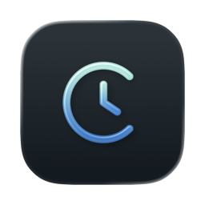</p>
<h1 align="center">CourseWatch</h1>
<p align="center"><strong>简体中文</strong> · <a href="README.en.md">English</a></p>
<p align="center">课程任务管理、个人日程与截止提醒。macOS 14+ / Windows 10+ x64。</p>
<p align="center">
  <a href="https://github.com/BeifengFlying/CourseWatch/actions/workflows/ci.yml"></a>
  <a href="CHANGELOG.md"></a>
  <a href="https://github.com/BeifengFlying/CourseWatch/releases" title="公开版本软件包累计下载次数，不含校验文件；每 15 分钟调度更新，调度与缓存可能延迟"></a>
  <a href="LICENSE"></a>
  <a href="package.json"></a>
  <a href="#安装"></a>
  <a href="docs/guides/WINDOWS.md"></a>
</p>
<p align="center"><a href="#安装">安装</a> · <a href="#功能与演示">功能演示</a> · <a href="#平台适配">平台适配</a> · <a href="#技术栈">技术栈</a> · <a href="#mac-性能与能耗实测">性能与能耗</a> · <a href="docs/guides/BUILD_HISTORY.md">更新记录</a></p>

**仅限非商业使用，禁止商用。** 适用范围、版本及再分发要求见[项目补充协议第八部分](TERMS.md#八禁止商用与再分发)。

CourseWatch 是面向 macOS 与 Windows 的课程任务管理工具，集中展示多个教学平台的作业、考试及截止时间。应用在本机定期同步所选课程，记录新任务与时间变化，并按配置发送提醒。个人日程可独立使用，无需绑定课程账号。

macOS 关闭主窗口后继续在菜单栏运行；Windows 可选择隐藏到系统托盘并保留后台，或退出应用。后台运行时保留任务检查与提醒。通知渠道包括桌面通知、邮件、网页推送和 iCloud 日历。

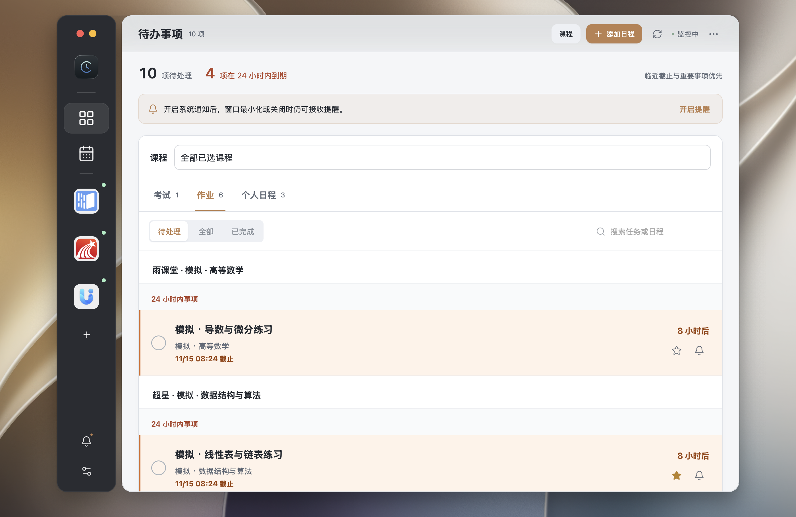

## 安装

当前版本：**0.2.36（测试版）**。可从 [GitHub Releases](https://github.com/BeifengFlying/CourseWatch/releases/tag/v0.2.36) 下载对应安装包。安装包不附带浏览器或文档展示图：

| 系统 | 下载 |
| --- | --- |
| macOS 14+ · Apple Silicon（M 系列） | [CourseWatch-0.2.36-mac-arm64.dmg](https://github.com/BeifengFlying/CourseWatch/releases/download/v0.2.36/CourseWatch-0.2.36-mac-arm64.dmg) |
| macOS 14+ · Intel | [CourseWatch-0.2.36-mac-x64.dmg](https://github.com/BeifengFlying/CourseWatch/releases/download/v0.2.36/CourseWatch-0.2.36-mac-x64.dmg) |
| Windows 10+ · x64 | [安装程序](https://github.com/BeifengFlying/CourseWatch/releases/download/v0.2.36/CourseWatch-0.2.36-win-x64-setup.exe) · [便携 ZIP](https://github.com/BeifengFlying/CourseWatch/releases/download/v0.2.36/CourseWatch-0.2.36-win-x64.zip) |

Windows 最低版本为 Windows 10 2004（内部版本 19041），建议使用 22H2 或更新版本。安装程序包含缺少 WebView2 时使用的微软在线引导程序；便携 ZIP 解压后运行 `CourseWatch.exe`。0.2.36 已通过 382 项测试、类型检查及协议弹窗 100%／150% 缩放检查；Windows 另含学习通网页课程登录校验修复。Windows 10、完整安装／升级／卸载及真实通知仍待实测，范围见 [Windows 0.2.36 验证](docs/verification/WINDOWS-0.2.36.md)。

首次打开且尚无当前修订确认记录时，应用显示《用户协议》全文、完全免费声明、项目源码地址及付费渠道退款举报提示；点击“同意并继续”后才启动后台。选择“退出软件”不保存确认记录，同一修订已确认后重启不重复弹出。0.2.36 更新协议修订，旧版确认需重新完成。

macOS 安装：打开 DMG，将 CourseWatch 拖入 Applications。升级前应从菜单栏退出应用，再替换旧版本；升级沿用原数据目录，建议提前备份重要数据。安装仍由使用者执行，历史安装包及校验文件按各自记录保留。

**安装包不附带浏览器。** 同步教学平台前需安装 [Chrome](https://www.google.com/chrome/) 或 [Edge](https://www.microsoft.com/edge)，并在“设置 → 通用”选择自动、Chrome 或 Edge。指定浏览器缺失时，应用提示安装或切换。CourseWatch 使用独立的浏览器资料目录；个人日程与本地提醒无需浏览器。

0.2.35 新增“设置 → 通用 → 应用更新”，提供手动检查和自动检查开关。自动检查默认开启，后台启动约 30 秒后检查，此后每天最多一次，包含项目公开测试版。同一版本只生成一条应用通知，并沿用已开启的系统通知；不发送邮件或网页推送。点击“查看更新并下载”进入对应 GitHub Release 页面，自行选择安装包，不自动下载或安装。已有安装包需升级到包含该功能的版本后才能使用，详见[更新验证](docs/verification/APP-UPDATES-2026-11-15.md)。

每个安装包附有同名 `.sha256` 文件，可执行以下命令核对：

```sh
shasum -a 256 CourseWatch-0.2.36-mac-arm64.dmg
```

macOS 包使用临时签名，尚未通过 Apple 公证。Intel 包已完成架构与 Rosetta 运行检查，Intel Mac 实机界面尚待验证。测试版的平台覆盖和提醒仍可能有遗漏，作业与考试请同时核对学校、教师和平台通知。详细说明见[测试版限制](DISCLAIMER.md)。

## 功能与演示

桌面展示图在本机 macOS 原生应用中实际截取，使用独立数据目录；课程、任务、日程及模型输出均为模拟数据，不含真实账号或课程信息。窗口周围保留 macOS 27 Golden Gate 壁纸，桌面组件、系统菜单栏及 Dock 不进入取景。邮件截图展示手机实际收到的模拟测试邮件。[截图来源与拍摄记录](docs/verification/README-DESKTOP-2026-11-15.md)。

### 选课与任务列表

登录平台后选择需要同步的课程并保存。任务支持按课程、类型和完成状态筛选。课程移除后可重新添加，个人标记保留；同名课程按平台课程／班级 ID 区分，无任务的课程仍保留在列表中。

首次同步不为已截止任务补发提醒。后续发现新任务或截止时间变化时，按提醒设置处理。

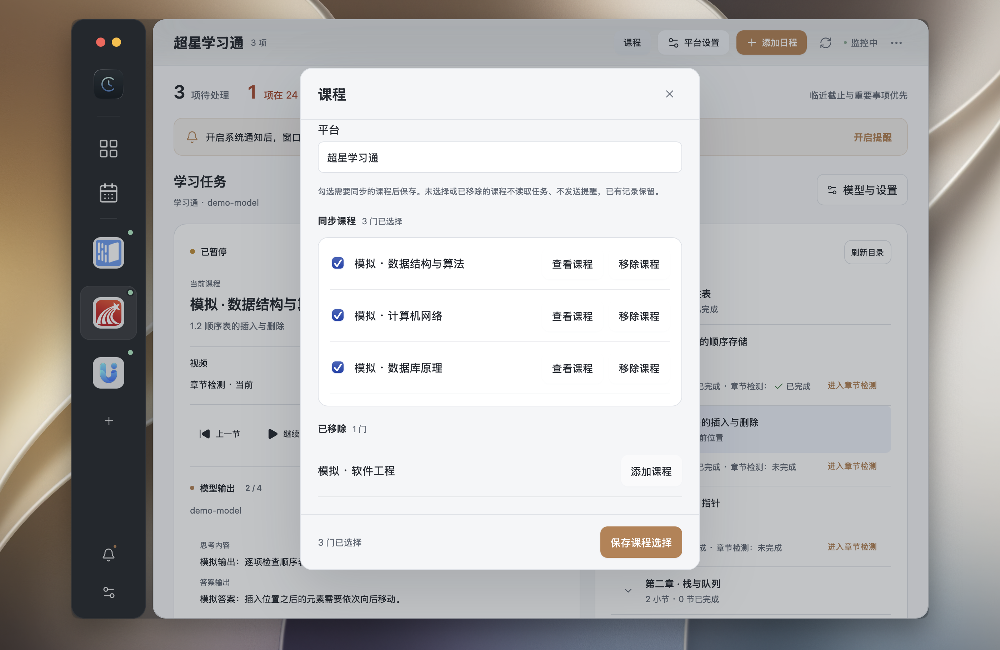

### 学习通完成状态

构建 30 新增章节、视频和章节检测的完成标识：已完成项目显示**绿色勾选图标与“已完成”文字**，支持浅色与深色主题。视频和检测的完成状态分别记录，视频完成不改变检测状态；未知状态保留原标记。

章节目录支持逐级展开、选择起点、继续上次章节或栏目，以及暂停后切换章节。官方任务点、章节完成状态和视频位置分别显示。

### 播放与学习控制

**学习通与 U校园实验功能仅用于技术实现验证与参考，不得用于其他目的。** 不得用于实际课程任务代办、获取成绩或学时、出勤证明、代学代刷、作弊或收费服务。使用者自行超出用途范围使用的，应依法承担相应后果；法律规定不能免除的责任不受影响。“技术验证”不构成平台授权或法律豁免，具体见[实验功能用途与自动化边界](docs/legal/AUTOMATION_BOUNDARIES.md)。

学习通与 U校园独立配置，试验功能默认关闭。播放、保持页面打开和后台保活无需模型；生成答案需配置模型地址、模型 ID 和 Key。模型设置支持获取模型列表与测试连接，运行界面展示接口返回的思考内容和答案。

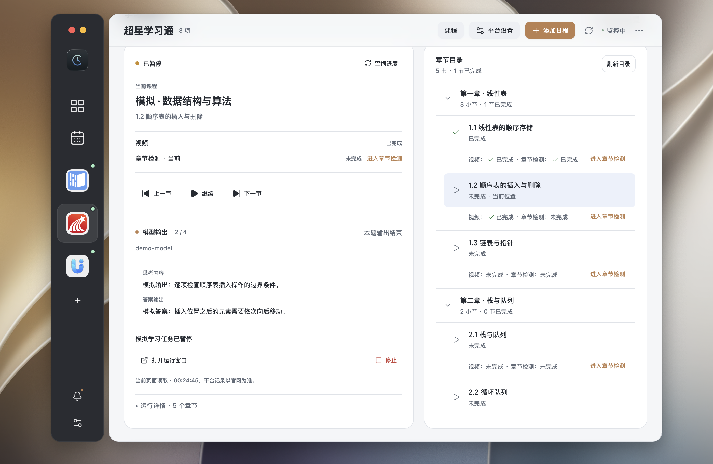

<details>
<summary>深色主题：学习控制与章节完成状态</summary>

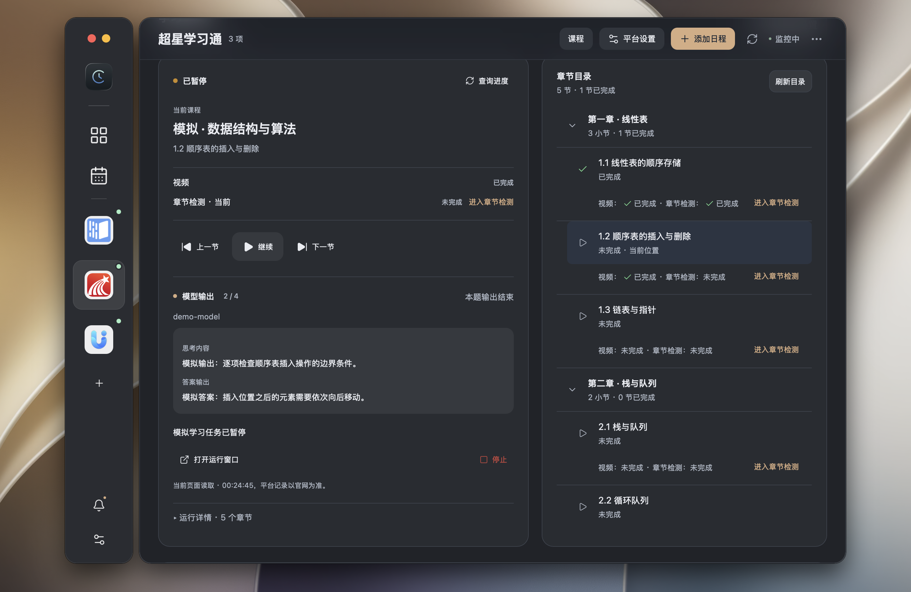

</details>

学习通支持配置播放期间是否处理章节测试。章节练习的自动填入、提交需要单独开启；视频弹题会穷举选项并真实提交，不调用模型，也不受练习自动提交或播放时章节测试开关控制。课程作业只生成答案，不处理已识别的考试及测评。题目替换字体在本机还原，内容无法完整读取时暂停，提交结果不明确时停止重试。

同一题连续两次空答案后，会将题干及选项发送到必应检索，再交给模型第三次作答；第三次仍为空时将题目、原始回复及搜索结果保存在本机 `study-model-logs/`，退出后不自动删除。接收方、费用及清理方式见[隐私说明](PRIVACY.md)。

U校园默认使用无界面浏览器，每 5 分钟保活，普通超时提示自动处理。选择“打开运行窗口”后暂停任务并切换至可见浏览器，继续任务后恢复后台模式；暂停期间停止保活。模式切换会重新载入官网页面，手动输入内容需提前保存，身份验证由使用者本人完成。学时以平台记录为准。

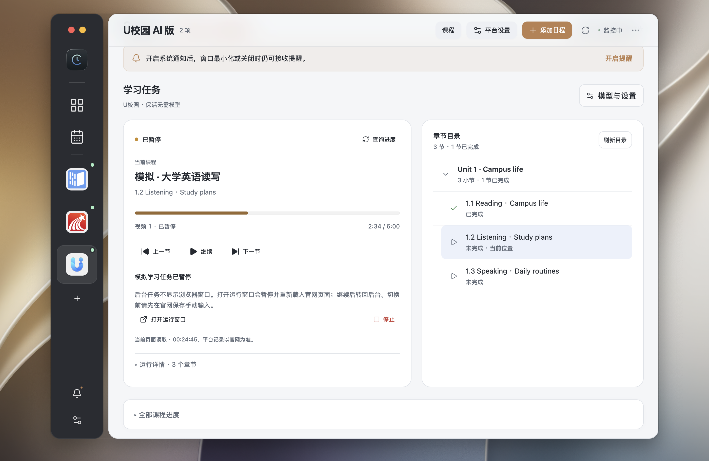

### 邮件、网页推送与 iCloud 日历

通知渠道在“设置 → 手机通知”中分别配置：

| 渠道 | 配置方式 |
| --- | --- |
| 邮件 | 使用两个不同的发件、收件邮箱，支持 465/TLS 和 587/STARTTLS |
| 网页推送 | 部署 HTTPS 订阅页并配对设备；iPhone／iPad 需要 iOS 16.4+，添加到主屏幕后授权 |
| iCloud 日历 | 在 Mac 上授权写入专用日历，并在同一 Apple 账号下启用日历同步；目前为单向同步 |

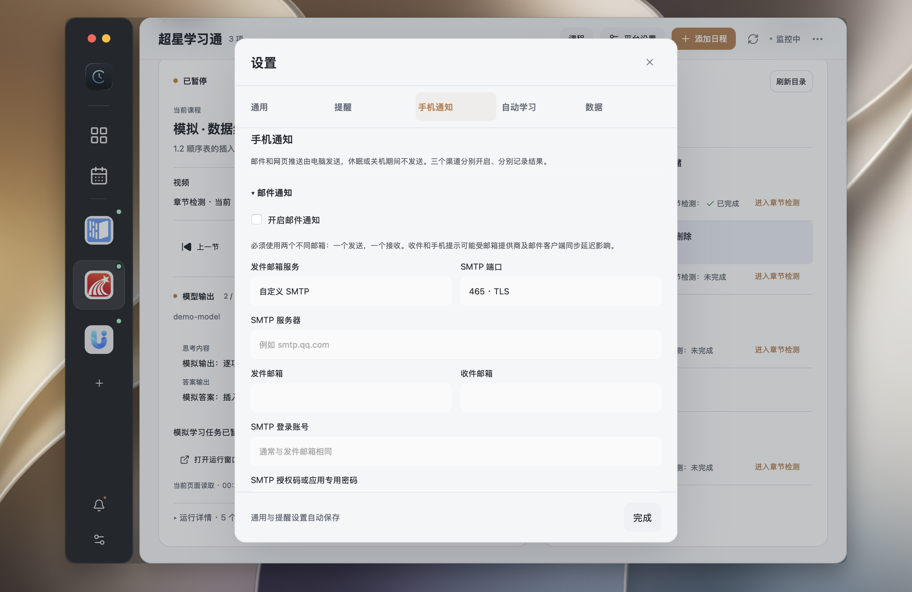

<details>
<summary>网页推送与 iCloud 日历设置</summary>


</details>

手机端测试邮件接收示例（收件人已隐藏）：

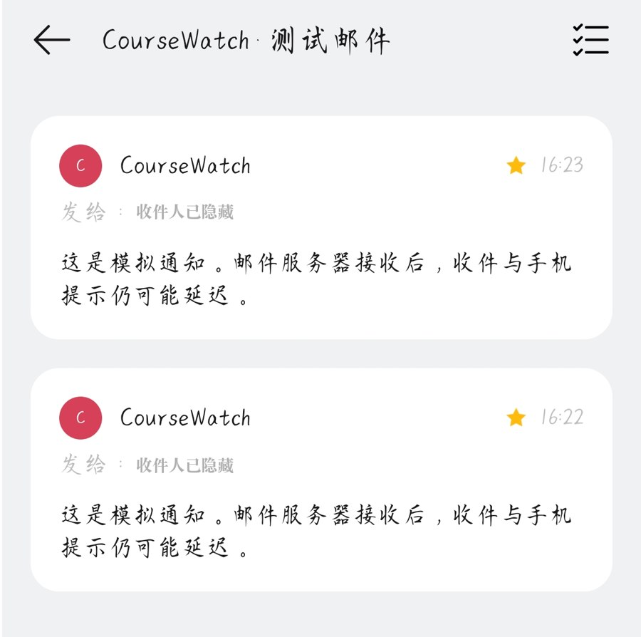

邮件和网页推送需要电脑保持运行、联网；休眠或关机后不会发送新消息。已同步到 iCloud 的事件仍可由手机日历提醒。手机端的延迟受邮件服务、网络和系统设置影响，网页推送与 iCloud 跨设备投递还需要实机核对。配置步骤见[手机通知说明](docs/guides/MOBILE_NOTIFICATIONS.md)。

### 菜单栏与个人日程

macOS 关闭主窗口、Windows 隐藏到托盘后，后台继续检查任务和发送提醒；退出应用后停止。Windows 首次关闭时询问隐藏到系统托盘或退出，可记住选择，并在“设置 → 通用 → 关闭窗口时”修改。首次启动分别询问后台运行和开机启动，开机启动默认关闭。macOS 菜单栏支持预览最多 6 项待办，以及查看学习进度、暂停、继续和切换章节。

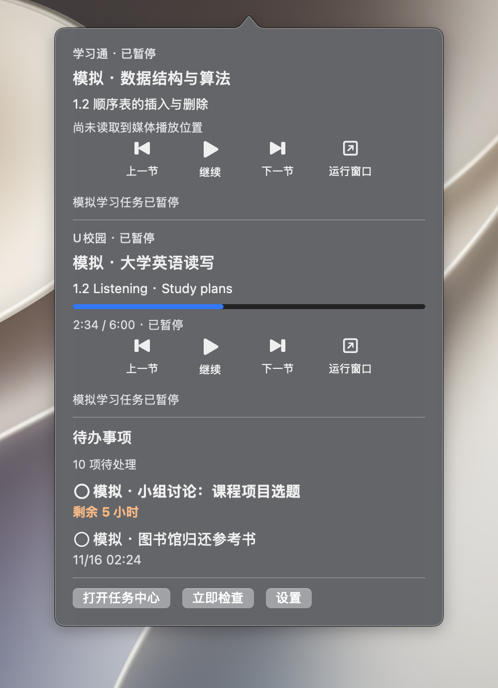

个人日程支持备注、星标、完成与撤销，以及多个提前提醒时间。应用中的个人完成标记仅用于本地列表管理，不会向教学平台提交任务。

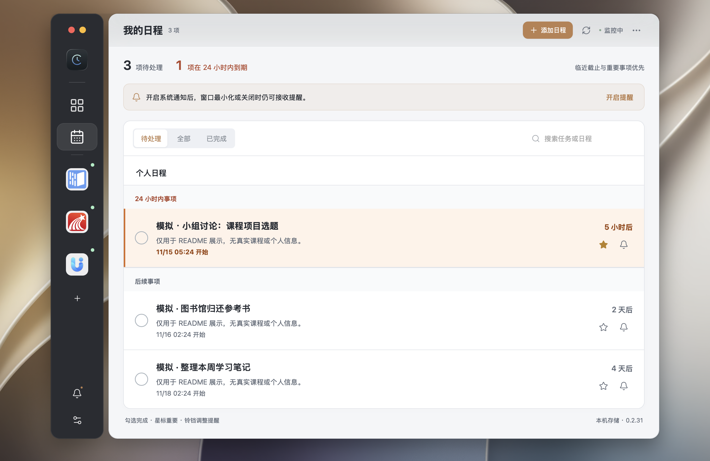

<details>
<summary>添加日程与单项提醒</summary>

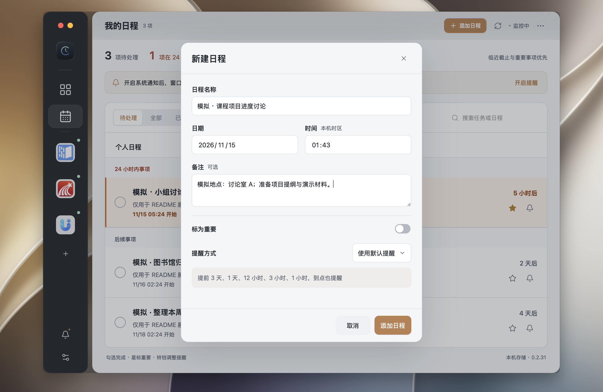

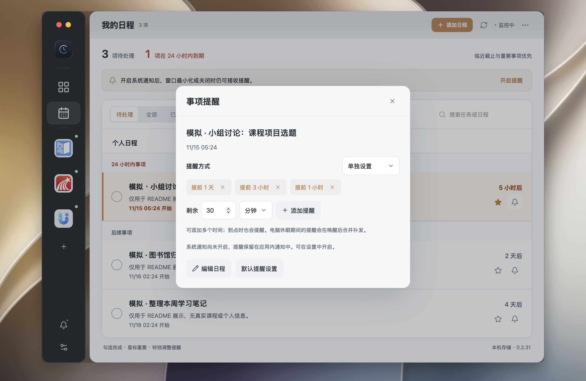

</details>

设置分为通用、提醒、手机通知、自动学习和数据五组，通用与提醒设置自动保存。运行详情与检查日志支持导出系统日志，重启后仍可导出；导出内容不包含登录凭据、模型 Key、题目正文和原始网页。

### Windows 窗口与外观

Windows 与 macOS 共用课程、学习及设置页面。“设置 → 通用 → 主题”可选择跟随系统、浅色或深色，选择自动保存；旧 Windows 显示模式设置会沿用到主题字段。

主窗口固定为 1060×720，平台窗口固定为 660×700，按系统缩放比例换算，工作区不足时缩小。窗口可移动；最小化和关闭按钮相邻，不提供最大化或边缘拉伸。设置面板固定为 680×600px，受可用范围约束，正文内部滚动。

侧栏和内容区各自保留圆角，外边距及两栏间隙显示桌面，移除整窗底板和外圈白框。以下为 0.2.30 r2 原生窗口检查截图，蓝色为后方测试背景，课程为虚构数据；合并后使用 0.2.31 的默认点缀色和主题入口。

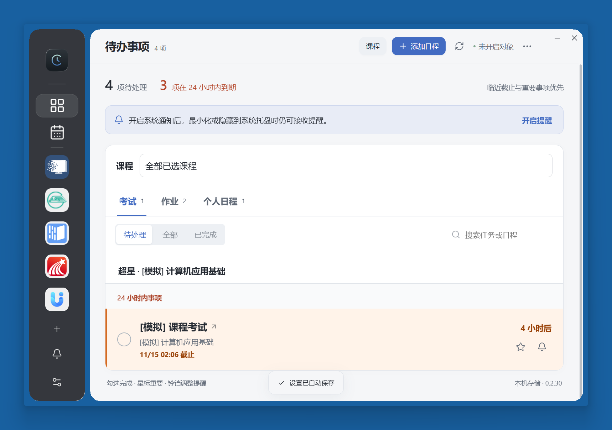

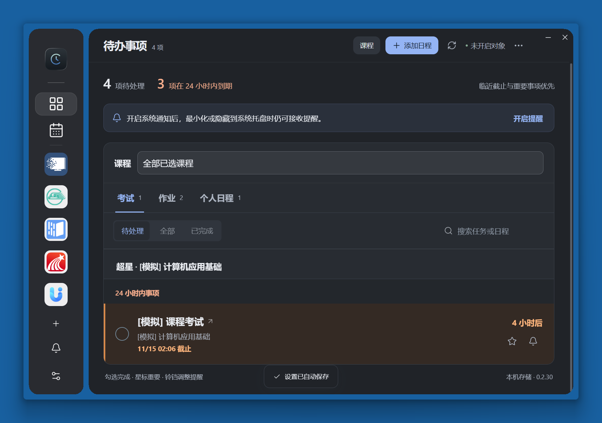

### 设置与通知记录

通用设置提供主题、点缀色、浏览器与检查频率；提醒设置配置系统通知和默认提前提醒。数据页面提供任务导出、备份与本地模拟实验。

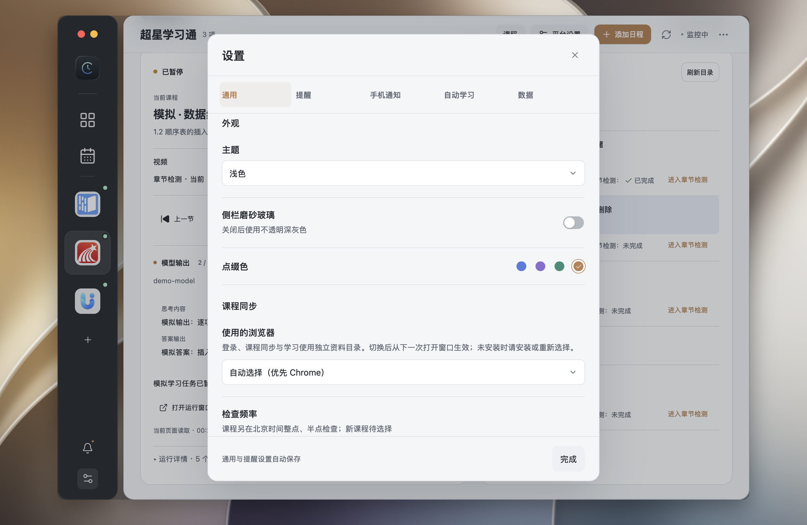

<details>
<summary>提醒、自动学习、数据与通知页面</summary>

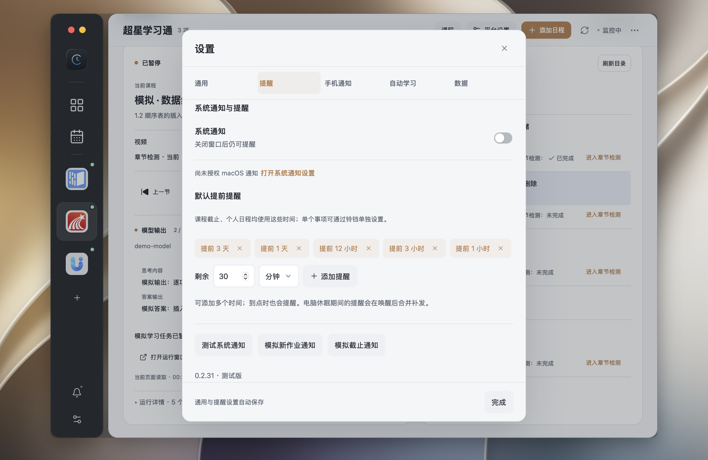

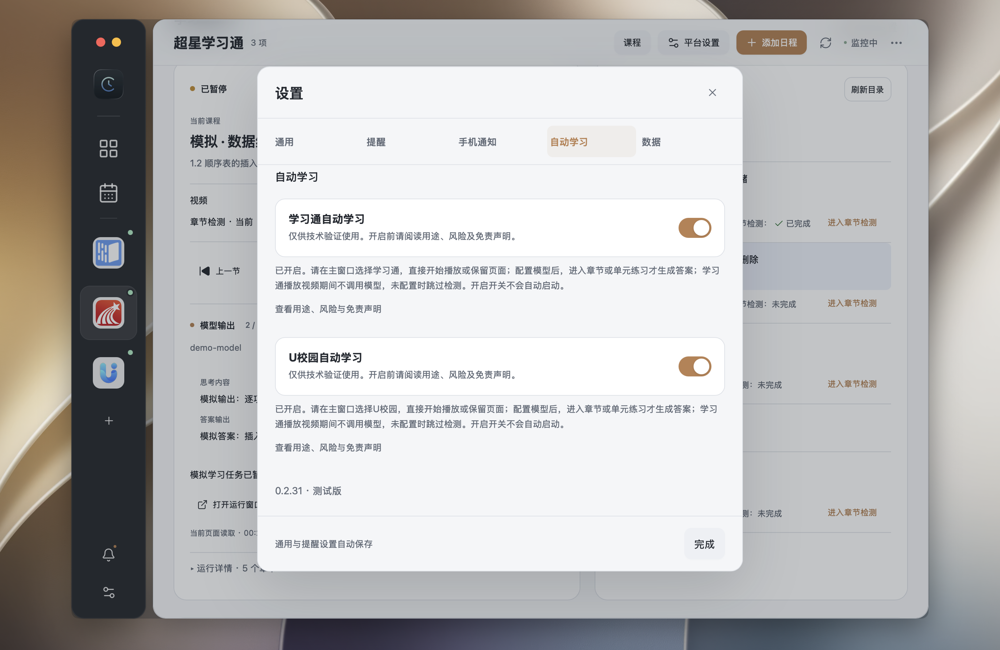

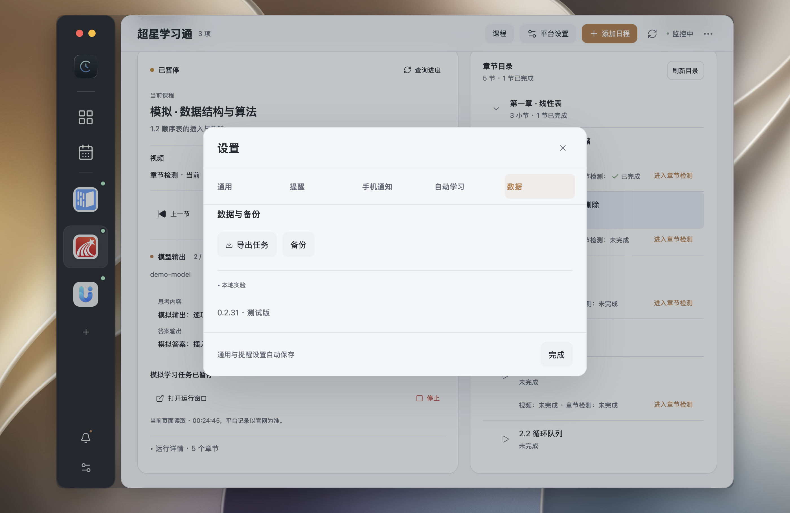

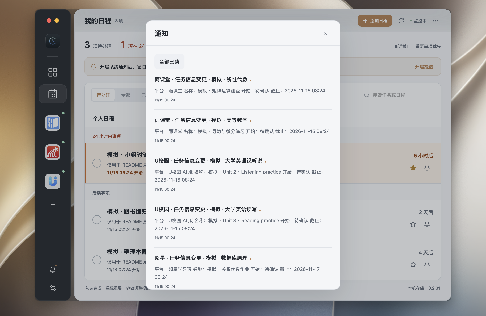

</details>

## 平台适配

| 平台 | 当前功能 |
| --- | --- |
| 云南省高等学校计算机等级考试系统（jsjks） | 已配置教学班的作业与考试列表 |
| 人卫中国医学教育题库 | 作业、考试列表 |
| 普通雨课堂（www.yuketang.cn） | 课程列表、活动作业与测验分页、官方考试类型识别 |
| 超星学习通 | 选课、按课同步作业与考试、任务时间、章节和官方进度查询、试验学习控制 |
| U校园 AI 版 | 教程书架、作业与考试汇总、独立学习控制；未关联教程的任务单独列出 |

当前维护范围以桌面端及表列平台为主。到梦空间已在构建 15 移除；浏览器扩展源码仍保留在仓库中。

仅同步明确选择的课程。登录失效或需要人工验证时，暂停对应平台；请求异常不视为空任务列表，部分同步失败不撤回已有任务。适配范围随学校、课程和题型而异，修复与测试记录见[构建历史](docs/guides/BUILD_HISTORY.md)。

## Mac 性能与能耗实测

测试日期：2026-11-14。设备：**MacBook Pro（M1 Max，32 GiB，macOS 15.7.4）**。使用构建 30 生产代码的隔离副本与 100 条模拟日程，保留后台提醒调度，无课程账号或模型请求。每种状态预热 15 秒、测量 120 秒，每 2 秒采样，统计包含原生外壳、Node 及可归属的 WebKit 辅助进程。

| 状态 | CPU 均值 | RSS 内存均值 | physical footprint 均值 | 进程数 |
| --- | ---: | ---: | ---: | ---: |
| 前台空闲 | 0.022% | 302.7 MiB | 169.3 MiB | 5 |
| 最小化 | 0.015% | 183.2 MiB | 76.3 MiB | 2–3 |
| 关闭主窗口 | 0.015% | 167.5 MiB | 70.1 MiB | 2 |

CPU 的 100% 表示一个逻辑核，RSS 合计可能重复统计共享页。表中数据为无账号环境的空闲占用；课程同步、浏览器及学习任务产生的额外开销未计入。

窗口最小化或隐藏后，应用保存草稿并释放 WebView；macOS 关闭窗口或 Windows 隐藏到托盘后，后台提醒继续运行。Windows 选择退出时停止后台。窗口失焦时停止界面轮询。磨砂玻璃默认关闭，浏览器按需启动，任务正常结束后回收。应用不会阻止系统休眠。

另使用 `powermetrics` 采样约 7 分钟、共 83 次，系统 CPU + GPU + ANE 的估算功率均值为 **2.39 W**，范围 **1.81–3.48 W**。该数值包含其他应用及同期学习任务的开销，属于系统芯片功率记录。CourseWatch 单独耗电量与电池续航尚无对照测试。

[完整测试方法与结果](docs/verification/MACOS-PERFORMANCE-2026-11-14.md) · [CPU／内存数据](docs/verification/macos-performance-2026-11-14.json) · [芯片功率数据](docs/verification/macos-power-2026-11-14.json)

## 更新记录

各次新增功能、平台适配和修复整理在[构建历史](docs/guides/BUILD_HISTORY.md)，原始记录保留在 [CHANGELOG](CHANGELOG.md)。

早期版本号与构建号采用独立编号：构建 1–27 主要沿用旧版本号，从构建 28 开始才使用 `0.2.<构建号>`。早期更新按构建号索引。构建 1–4 的独立记录缺失，已在表中注明；构建 9–29 大多是本机更新。

## 技术栈

| 模块 | 技术 |
| --- | --- |
| 界面 | Vue 3、TypeScript 6、Vite 8、Lucide；扩展界面使用 Naive UI |
| 本地服务 | Node.js 24、Fastify 5、Zod 4 |
| 数据存储 | SQLite、better-sqlite3 |
| 平台读取与浏览器控制 | Playwright、Cheerio；使用本机 Chrome／Edge |
| macOS 外壳 | Swift、AppKit、WKWebView、UserNotifications、EventKit |
| Windows 外壳与安装 | C#、.NET 10、WinForms、WebView2、Inno Setup 6 |
| 浏览器扩展 | WXT、Vue |
| 通知 | Nodemailer（SMTP）、web-push、node-notifier、二维码配对 |
| 检查与测试 | vue-tsc、Vitest、Playwright |

## 开发与构建

桌面端共用 Vue 界面和 Node / SQLite 后台，Mac 使用 AppKit / WKWebView 外壳，Windows 使用 WinForms / WebView2。

需要 Node.js 24。macOS 打包需要 Xcode Command Line Tools；Intel 交叉构建的运行检查需要 Rosetta。

```sh
npm ci
npm run browser:install       # 仅供开发测试，不进入安装包
npm run typecheck
npm test -- --maxWorkers=2
npm run build:mac:all         # Apple Silicon + Intel
```

Windows 需要 .NET 10 SDK、Inno Setup 6，以及本机安装的 Chrome 或 Edge。详见 [Windows 构建说明](docs/guides/WINDOWS.md)。

```powershell
git pull origin main
npm ci
npm run build:win
```

打包前会校验固定版本的上游文件及[受保护学习逻辑](docs/guides/STUDY_PROTECTED_LOGIC.md)。安装包文件名包含版本和构建号，同名包及校验文件不会覆盖。构建产物 `build/`、`dist/`、`.cache/` 不提交到 Git。

本地数据目录：

- macOS：`~/Library/Application Support/CourseWatch/`
- Windows：`%LOCALAPPDATA%\CourseWatch`

会话快照与通知密钥使用系统凭据保护，数据库和浏览器资料目录未整体加密。任务导出不包含登录会话，备份或迁移前请查看[数据与隐私说明](PRIVACY.md)。更多内容见[文档目录](docs/README.md)和[脚本说明](scripts/README.md)。

## Contributing

欢迎提交 PR！无论是修复 bug、改进文档还是新增功能都很欢迎。

- 提交前请先搜索是否已有相关 Issue
- 较大改动建议先开 Issue 讨论
- 请尽量保持提交清晰，并补充必要测试/文档

第三方来源、贡献许可及受保护逻辑要求见[贡献说明](CONTRIBUTING.md)。

## 反馈与许可

问题反馈请提交至 [Issues](https://github.com/BeifengFlying/CourseWatch/issues)，注明版本与构建号、操作系统、教学平台及复现步骤。涉及页面差异时请附脱敏截图。账号、Cookie、数据库及浏览器资料不得公开上传，日志应检查并脱敏后提交。

本项目基于 [Apache-2.0](LICENSE) 及[项目协议](TERMS.md)发行。`LICENSE` 保留标准原文，新增项目约定统一写入 TERMS；禁止商用、免费分发及实验用途约定见项目协议第六、八部分。项目补充约定不是 Apache-2.0 自带条款，不能单方面撤回既有有效授权。当前测试版免费，不接受广告合作或捐赠。第三方代码、平台名称和图标来源见[第三方声明](THIRD_PARTY_NOTICES.md)，依赖许可未决项见[许可核查记录](docs/legal/RELEASE_LICENSE_REVIEW.md)。
