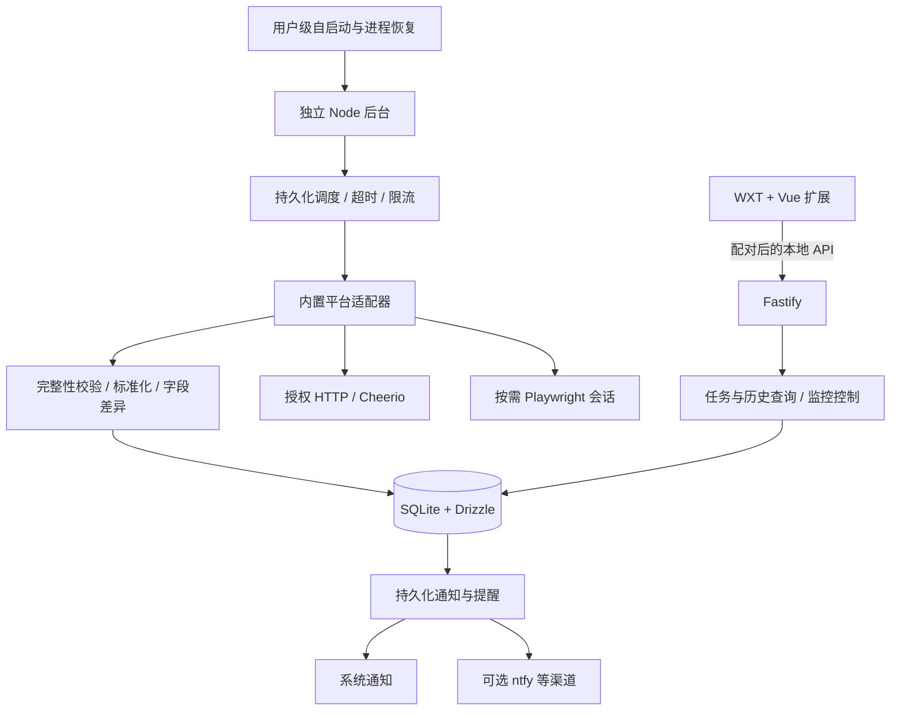

# 整合与验证方案

本文件保留实施设计与验收门槛。当前已实现 0.1.0 实验核心和界面，平台完整采集、系统分发仍待验证；实际进展见 [实验说明](../verification/EXPERIMENT-0.1.1.md) 与 [验证记录](../verification/VALIDATION.md)。依据 [原需求](PRD.md)、[可行性研究](FEASIBILITY.md) 与 [开源选型](OPEN_SOURCE.md)。

修订后的实施约束：jsjks 与人卫优先；jsjks 监控教学班内作业和考试的发布、截止时间及其变化；其他平台优先整合现有项目；macOS 与 Windows 11 同属首版验收目标。以下顺序取代原需求中将云南平台后置的顺序。[跨平台系统适配](CROSS_PLATFORM.md)与核心数据链路一起推进。

新增约束：长期后台轻量运行，首版不采用常驻 Electron 或浏览器。遵守[资源预算](RESOURCE_BUDGET.md)。jsjks 已观察到主站教学班与编程作业列表；后续应验证图文作业、课堂实验与考试的覆盖，不能把编程作业列表当作全部作业。

实现说明：0.1.0 使用 npm lockfile 与 better-sqlite3 直接访问；Drizzle 初始化在本机引入约 130 MiB 额外 RSS，已移除，不作为轻量后台依赖。原架构图中的 Drizzle 仍为早期选型记录。

## 1. 模块边界



浏览器扩展的 Service Worker 只处理短期通信与界面事件；不持有唯一任务调度器。平台正常网页登录与 CourseWatch 本地服务配对是两套不同的授权流程。

建议目录：

```text
apps/extension/       WXT 入口、Popup、Dashboard、Settings
apps/local-service/   生命周期、API、本地认证、启动入口
packages/contracts/   Zod schema、版本化 API/采集协议
packages/core/        变化引擎、提醒规则、账号隔离
packages/storage/     Drizzle 表与迁移、事务、备份
packages/adapters/    人卫/学习通/雨课堂/云南内置适配器
packages/notifications/ 渠道接口、系统通知与后续可选渠道
scripts/             开发命令与用户级系统集成
tests/fixtures/      经脱敏的 HTML/JSON，不含真实认证信息
```

## 2. 采集契约必须携带证据

原需求中的 `RawTask[]` 不能表达完整性。以下为接口草案，待平台探索后定稿，并非已经实现的 SDK：

```ts
type ScanResult = {
  scanId: string;
  platform: string;
  accountId: string;      // 本地生成，不使用明文学号充当标识
  siteKey: string;        // 已验证站点/租户
  adapterVersion: string;
  startedAt: number;
  finishedAt: number;
  outcome: 'complete' | 'partial' | 'failed' | 'auth_required'
    | 'verification_required';
  discoveryComplete: boolean; // 课程/监控分区本身是否枚举完整
  partitions: Array<{
    key: string;         // 课程/班级/任务类别等来源作用域
    outcome: 'complete' | 'partial' | 'failed';
    paginationComplete: boolean;
    emptyConfirmed: boolean;
    items: RawTask[];
    issues: ScanIssue[];  // 网络、schema、详情字段、限流等错误
  }>;
};
```

具体 `RawTask` 和 `ScanIssue` schema 在开发前补齐，错误信息不得携带原始 headers、完整会话 URL 或账号页面正文。

处理规则：

- 登录判断同时看最终地址、页面/响应形状与用户身份探测，不能只看 HTTP 200 或 Cookie 存在。
- 对每个必需字段做 schema 校验；字段未知、格式变更与合法空列表分别表示。
- 分区粒度按真实来源选择。课程列表不完整时，未枚举课程保留原状态；列表完整但详情读取失败时，标记字段级不完整。
- 每一页检查响应及去重，记录稳定分页终止证据；达到安全页数/时间上限只能返回部分结果。
- 失败保留旧任务与最后成功时间；成功项可更新，但不会覆盖旧的可信字段为失败产生的空值。
- 任务未出现记为待核实。即使多次完整扫描缺失，也不自动证明撤回；有明确撤回字段或用户核实后再取消。
- 适配器隔离超时、取消信号与错误；某平台挂起不占住其他平台的全部执行槽。

## 3. 会话与传输选择

1. 用户点击平台登录后，后台打开独立 Playwright 配置目录中的官方页面，由用户自行登录与完成验证。
2. 根据经验证的身份探测确认登录；保存到本机当前用户的数据目录，每个平台/本地账号隔离。
3. 若平台允许同等授权的 HTTP 读取，使用正确的 Cookie jar/请求上下文；保留 Domain、Path、Secure、过期等语义，更新的 Cookie 需正确回写，不能只复制一次 Cookie 字符串。
4. 若令牌依赖 localStorage、IndexedDB、页面生成头或其他浏览器状态，验证具体来源；不能假设 `storageState` 自动覆盖一切，尤其 sessionStorage 需要专门处理。
5. 必须渲染时，在后台按需运行受管浏览器，完成后立即回收。设置执行超时、进程数量和重试上限，闲置时不保留浏览器子进程。浏览器 DOM 解析与 Browser 采集共用会话机制，DOM 不是另一套长期运行端。
6. 会话过期或要求验证时暂停该平台、去重提示，保留缓存；禁止无限重试登录或自动处理验证码。

Playwright 的 `browserContext.request` 可作为共享 Cookie 状态的 HTTP 路径候选，但是否满足某平台完整认证必须实测。平台采集与扩展无需读取用户日常浏览器的全部 Cookie；独立浏览器也不与普通 Chrome 共用 profile。

正式数据路径使用系统用户目录，而不是项目根或安装目录：macOS 的 Application Support/Logs，Windows 的 LocalAppData；具体子路径在实现时固定。令牌用系统凭据库或经过验证的安全存储，profile 设当前用户权限。profile 不等于已整体加密，需明确本机用户访问边界。导出、备份默认排除会话。

## 4. 任务模型与数据库修订

任务身份由“平台 + 本地账号 + 站点/租户 + 来源命名空间 + 原任务 ID”构成，命名空间是否含课程/班级/类型取决于真实 ID 唯一性。采用内部 UUID 与来源键映射，避免用户改名或修改标题时重建任务。

时间字段使用毫秒，同时保存 `sourceTimezone`、原始时间文本/格式与字段可信度。需区分无期限、未知期限、来源明确期限、推断期限。来自课程结束时间的推断值最多用于另行展示，不参与权威 DDL 提醒。

来源状态、本地截止状态、个人标记分别保存：

| 信息 | 示例 | 解释 |
| --- | --- | --- |
| 来源提交状态 | 未提交 / 进行中 / 已提交 / 已批阅 / 未知 | 平台事实，未知不能用本地勾选替换 |
| 时间状态 | 未开始 / 可进行 / 已逾期 / 时间未知 | 根据可信开始/截止时间计算 |
| 本地个人标记 | 已读、隐藏、个人完成 | 仅影响个人视图及明确配置的提醒策略 |
| 观察信息 | 首次发现、最后成功看见、状态观察时刻 | 不等同平台发布时间或提交时间 |

原表之外建议补充 `accounts`、`scans`/`scan_partitions`、`task_source_mappings`、`reminder_jobs`、`notification_outbox`、`notification_deliveries`。已有 `scan_logs` 和 `notifications` 也可承载部分功能，但业务状态不能只存在纯文本日志中。

事务写入顺序：校验快照 → 读取来源任务 → 计算字段差异 → 更新任务 → 插入历史 → 更新提醒计划 → 插入 Outbox → 提交。通知进程只消费已提交事件，不在数据库事务中等待系统通知调用。

SQLite 使用事务和有界写操作；评估 WAL 与 busy timeout。备份采用 SQLite 一致性备份机制，或受控 checkpoint/停写后备份；不能在 WAL 活跃时只复制主数据库文件。迁移前备份，并实际验证恢复与旧版本兼容策略。

## 5. 调度、休眠与通知语义

- 默认每平台 15 分钟，可按平台实际限制调长；扫描起点错开，加入小幅抖动，同一账号不重叠扫描。所有账号共享单实例数据库写入者。
- 调度计划持久化，进程启动与恢复后先核对已到期任务；普通 `setInterval` 仅用于唤醒调度器，不承担持久状态。
- 瞬态网络错误用有上限的指数退避；429 尊重 Retry-After；认证、验证与解析错误分开熔断，不盲目重试。
- 用壁钟时间计算绝对截止，单调时钟/周期差距辅助检测长暂停；系统时钟跳变、系统时区改变与休眠都进入重新核对流程。
- 唤醒后各平台错峰补查。休眠期间错过多个提醒窗口时，按任务合并为当前最有意义的一条，已完成任务停止提醒。
- 首次全量同步默认建立基线并给摘要，避免对所有历史任务逐条“新发布”通知；基线建立后新增的任务在成功扫描发现后通知。“立即”指发现并持久化后，而非平台发布的同一瞬间。
- 一条提醒的持久去重键至少含 `taskId + reminderRuleId + ruleVersion + channelId + deadlineVersion`；非 DDL 事件使用对应事件/字段版本。重扫不改变版本，相同时间格式归一后不产生新版本。
- DDL 改动先撤销旧计划，再生成新计划；需要保留已发送历史。判断完成后停止截止提醒，提交状态未知时提示信息不确定。
- 领取 Outbox 任务需要租约/重试状态。崩溃点位于“系统已接收、数据库尚未标记”时，外部通知无法天然保证严格只发一次；尽可能使用稳定通知标识与替换/归并，文案不承诺 exactly-once。

原生通知、扩展、未来远端通知共享事件 ID，并按用户选择分发；默认系统渠道负责桌面提醒，避免三个渠道同时重复打扰。远端推送必须由用户启用，并支持隐藏课程标题等内容；不会上传登录态。

## 6. 本地 API 与配对

默认仅绑定 `127.0.0.1:17321`。端口冲突时明确报错并引导，不转为 `0.0.0.0`。如支持 IPv6，需单独限制 `::1` 与 Host，不假设 localhost 的解析行为恒定。

首次配对由本地应用/CLI 产生短期一次性码，在用户主动操作的扩展设置页输入；后台验证并将随机高强度客户端令牌交给该扩展。限制尝试次数与有效期，允许撤销和轮换，不通过公开接口泄露长期令牌。

每次请求验证令牌、Host、允许的操作与请求 schema。扩展来源按生产 ID/已配对开发 ID 管理；存在 Origin 时必须严格校验，不接受 `*`、`null` 或任意扩展来源。部分扩展请求可能没有 Origin，因此“没有 Origin”不能作为授权依据，仍要求令牌和其他限制。普通网页不获得读取/控制本地服务的接口。

扩展通过准确的 loopback host permission 从扩展页面或 Service Worker 请求；不让教学网页中的 Content Script 充当任意 URL 代理。host permission 不代替服务端鉴权，也不保证不同浏览器版本的本地网络策略完全一致，需在目标 Chrome/Edge 版本验证。

WebSocket 同样鉴权与限制来源；浏览器 WebSocket 不能直接设置任意 Authorization 请求头，建议先经认证 HTTP 获取短效一次性连接票据。若票据放在握手 URL 中，必须关闭 URL 敏感参数日志、限制有效期与单次使用；认证完成前不发送任务信息，限制未认证连接时间和数量。首版也可先用 UI 可见时的定时拉取，待确认实时需求后加 WebSocket。

HTTP API 的可用性依赖本地服务已启动。第一版由安装后的用户级自启动和显式启动入口处理；扩展启动服务的功能需通过带白名单的 Native Messaging 控制桥实现，并由系统主管独立持有后台进程生命周期。

不暴露任意执行命令、读取文件、转发 URL、导出会话的 API；不将令牌放入普通日志。界面外链限制为已确认的平台 HTTPS 域名，标题/描述按文本渲染，避免来源 HTML 注入扩展。

## 7. 实施顺序与验收门槛

| 阶段 | 工作与复用 | 验收后才能进入下一阶段 |
| --- | --- | --- |
| A · 风险探索 | jsjks、人卫分别登录/只读探测；最小 Playwright 会话；两系统通知、自启动与分发 PoC | 分别核实真实任务 ID/时间/分页；浏览器退出与后台重启后可重查；记录操作系统证据 |
| B · 共享核心 | pnpm/TS；Zod 契约；SQLite/Drizzle；差异/历史/Outbox/提醒 | 模拟平台通过故障和持久化用例；明确标识为模拟，不能称平台已适配 |
| C · 首批双平台集成 | 将 A 中 jsjks 教学班作业/考试、人卫教学任务分别接入核心，用户级常驻 | 每个平台真实数据与页面对照一致；发布发现、截止与时间变化有证据；失效登录不损坏缓存 |
| D · 扩展与通信 | WXT/Vue；配对与任务列表；最小设置 | 认证/断连/过期数据状态真实；普通网页不能控制 API；关闭浏览器监控继续 |
| E · 现有项目整合 | 优先以 xxt-Tool 和 chaoxing-journal 的 MIT 只读实现整合学习通、雨课堂 | 移植来源和修改可追溯；补上完整性与可信度；两个桌面系统及每个平台独立验收 |
| F · 完整界面与发行 | FullCalendar 标准日历；安装、更新、备份、许可清单 | Win/mac 实机安装卸载；恢复备份；通知身份/点击；版本迁移与更新失败恢复 |

jsjks 与人卫均为首批必验平台；在 A 阶段找到 jsjks 登录后的教学班入口，核实教学班作用域、作业/考试列表、发布时间、截止时间与分页，同时探索人卫作业/考试。仅发布确实存在且实测的字段，缺失保持未知，不执行业务写操作。如果其中一项不可行，记录失败证据与可接受降级，再讨论发布范围。发布范围变更需明确记录；单平台演示仅说明该平台的实现进展。复杂 UI 不应先于数据链路可行性。

不在平台上主动创建/修改/提交教学任务以制造测试；可用真实自然变化做观测、经授权的测试课程做对照，其余故障与变更场景用脱敏 fixture/本地模拟验证，明确区分证据类别。

## 8. 验证矩阵

| 范围 | 必须覆盖的情况 | 通过条件 |
| --- | --- | --- |
| 采集 | 正常列表、合法零条、200 登录页、超时、验证码、429、schema 变化 | 正确分类，异常与空列表分别处理 |
| 完整性 | 多页、重复页、缺页、单课程失败、列表成功而详情失败 | 扫描/分区/字段完整性可追溯，旧数据不被误删 |
| 身份 | 同名任务、跨课重号、换账号、区域域名、任务改名 | 无误合并、账号泄漏或重复建任务 |
| 时间 | 秒/毫秒、无年份、无期限、未知、跨时区/夏令时、改系统时钟 | 不猜未知，等价时间不触发重复 DDL 变化 |
| 状态 | 已提交未批阅、已逾期但已提交、个人勾选、来源未知 | 未批阅与未提交分别处理，不混淆个人与平台状态 |
| 提醒 | 首次基线、重复扫描、DDL 修改/取消、规则修改、多渠道、崩溃重启 | 历史完整，旧计划失效，可解释重试与重复边界 |
| 生命周期 | 浏览器全退出、后台崩溃、系统登出/登录、休眠唤醒、断网恢复 | 独立后台可恢复；休眠提醒合并且重新校验 |
| 安全 | 错误 Host/Origin/令牌、未配对扩展、WS 未鉴权、敏感日志、导出 | 未授权访问被拒，导出不带凭据 |
| 发行 | Windows 11（CPU 架构待核实，先拟 x64）、macOS arm64 / x64 的独立构建与系统验收 | Playwright/SQLite 原生依赖、通知与升级在各声明架构验证；未经验证的架构不列为已支持 |

平台验收应提供脱敏的“页面显示值 → 来源字段 → 标准任务 → 提醒结果”对照，以及实验日期、适配器版本和环境。资源测试记录空闲/扫描峰值内存、CPU、浏览器启动次数、请求数量与 24 小时异常恢复，按[资源预算](RESOURCE_BUDGET.md)验收；当前目标尚未实测，不得写成已经达标。
